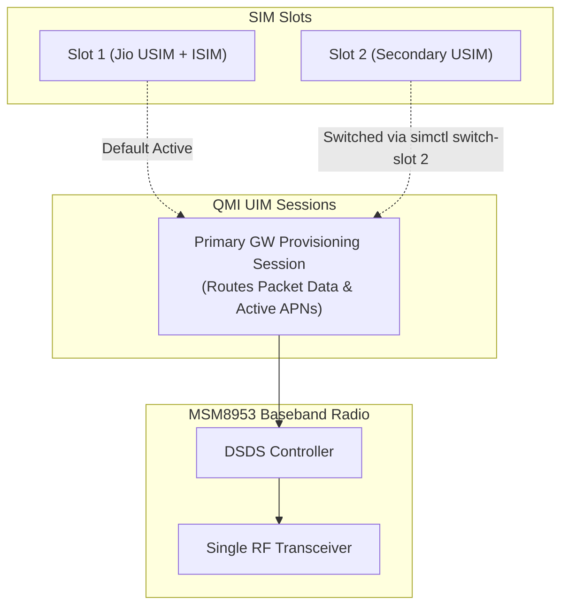

# `simctl` User Guide & Operator Manual

`simctl` (formerly `dimsd`, preserved via `/usr/local/bin/dimsd` symlink) is an enterprise-grade cellular modem and SIM management utility built in Rust for **Nura OS** (postmarketOS / Alpine Linux on Qualcomm Snapdragon MSM8953 / `aarch64`).

This guide covers architecture, command syntax, step-by-step practical workflows, configuration options, systemd service management, and troubleshooting.

---

## Table of Contents

1. [System Concepts & Modem Architecture](#1-system-concepts--modem-architecture)
   - [Why Disable IMS/VoLTE?](#why-disable-imsvolte)
   - [Dual SIM Dual Standby (DSDS) & Provisioning Sessions](#dual-sim-dual-standby-dsds--provisioning-sessions)
   - [Dual-Layer Modem Architecture (QMI + ModemManager)](#dual-layer-modem-architecture-qmi--modemmanager)
2. [Prerequisites & Privilege Requirements](#2-prerequisites--privilege-requirements)
3. [Quick Start](#3-quick-start)
4. [CLI Command Reference](#4-cli-command-reference)
   - [`simctl status` (Check System & SIM State)](#simctl-status)
   - [`simctl switch-slot` (Inspect Slots & Switch Primary Data SIM)](#simctl-switch-slot)
   - [`simctl disable` (Disable IMS/VoLTE)](#simctl-disable)
   - [`simctl enable` (Re-enable IMS/VoLTE)](#simctl-enable)
   - [`simctl profile` (WDS APN Management)](#simctl-profile)
   - [`simctl check` (Hardware & Port Sync)](#simctl-check)
   - [`simctl daemon` (Boot & Watchdog Mode)](#simctl-daemon)
5. [Common Practical Workflows](#5-common-practical-workflows)
   - [Workflow A: Inspect Slots and Switch Primary SIM](#workflow-a-inspect-slots-and-switch-primary-sim)
   - [Workflow B: Disable IMS across All SIMs](#workflow-b-disable-ims-across-all-sims)
   - [Workflow C: Create, Verify, and Delete Custom APNs](#workflow-c-create-verify-and-delete-custom-apns)
   - [Workflow D: Scripting with JSON Output](#workflow-d-scripting-with-json-output)
6. [Configuration File Reference (`/etc/simctl/config.toml`)](#6-configuration-file-reference-etcsimctlconfigtoml)
7. [Systemd Service Management](#7-systemd-service-management)
8. [Troubleshooting & Frequently Asked Questions](#8-troubleshooting--frequently-asked-questions)

---

## 1. System Concepts & Modem Architecture

### Why Disable IMS/VoLTE?
In modern cellular modems, the **IP Multimedia Subsystem (IMS)** automatically attempts to register with carrier networks to provide Voice over LTE (VoLTE), Video over LTE (ViLTE), and SMS over IP (SMSoIP). 

On specialized Linux distributions such as Nura OS, this automatic registration can cause:
- **Excessive Battery Consumption**: Background SIP keep-alives and unsolicited bearer attempts drain device battery.
- **Unwanted Radio Wakeups**: The cellular baseband wakes the host CPU continuously to service IMS registrations.
- **Carrier Profile Clashes**: When roaming or using IoT/data-only SIMs, failed IMS registrations can trigger carrier throttling or connection instability.
- **Security & Privacy Considerations**: IMS profiles transmit SIP identity data across background radio channels.

`simctl` cleanly disables the IMS subsystem at the hardware NVRAM profile layer while **preserving general packet data connectivity** (`internet`, `jionet`, etc.).

### Dual SIM Dual Standby (DSDS) & Provisioning Sessions
The Qualcomm MSM8953 modem operates in **Dual SIM Dual Standby (DSDS)**:
- **Single RF Transceiver**: Both SIM cards share a single baseband radio.
- **Standby Mode**: Both SIM 1 and SIM 2 can remain registered to cell towers to receive incoming calls or SMS.
- **Single Packet Data Session (Primary GW)**: Only **one** SIM can have an active data session and routable IP interface at any given moment.
- **Dynamic NVRAM Swapping**: Qualcomm modems bind their active WDS (Wireless Data Service) 3GPP APN profile table to the card holding the `Primary GW` provisioning session. When you switch sessions between Slot 1 and Slot 2, the modem dynamically swaps which profile table is active.



### Dual-Layer Modem Architecture (QMI + ModemManager)
`simctl` interacts with the modem through two coordinated software layers:
1. **Qualcomm QMI Subsystem (`qrtr://0` / `qmicli`)**:
   - Manages card-level states, USIM/ISIM Application IDs (AIDs), and WDS 3GPP APN profile registers directly in modem non-volatile memory (NVRAM).
2. **ModemManager D-Bus Layer (`mmcli`)**:
   - Manages high-level cellular connections, interface state machines (`rmnet_ipa0`, `qmapmux0.X`), and active bearer teardown.

To eliminate race conditions, `simctl` enforces a strict sequence:
1. Disable the WDS 3GPP profile in QMI NVRAM (`disabled=yes`).
2. Disconnect any active ModemManager bearer for APN `ims`.
3. If ModemManager attempts an automatic reconnect, the baseband immediately rejects it (`pdn-call-throttled`), permanently terminating IMS registration.

---

## 2. Prerequisites & Privilege Requirements

- **Operating System**: Nura OS / Alpine Linux / postmarketOS (`aarch64`).
- **Kernel**: Linux kernel with QRTR and IPA drivers enabled (`msm8953`).
- **Dependencies**: `/usr/sbin/qmicli`, `/usr/sbin/mmcli`, `ModemManager`, `qmi-proxy`.

> [!IMPORTANT]
> **Root Privileges (`sudo`)**:
> Access to the QMI socket router (`qrtr://0`) and `qmi-proxy` requires root permissions. Always run `simctl` using `sudo` (e.g. `sudo simctl status`, `sudo simctl disable`). Running without `sudo` will cause QMI commands to fail with `Client group not allowed: Not enough privileges`.

---

## 3. Quick Start

```bash
# 1. View full status of both SIM slots, APN profiles, and bearers
sudo simctl status

# 2. Inspect available slots and view switch suggestions
sudo simctl switch-slot

# 3. Switch mobile data to SIM Slot 2 (auto-disables IMS on newly active slot)
sudo simctl switch-slot 2

# 4. Switch mobile data back to SIM Slot 1
sudo simctl switch-slot 1

# 5. Disable IMS/VoLTE across all present SIM slots (default)
sudo simctl disable
```

---

## 4. CLI Command Reference

### `dimsd status`
Displays a comprehensive overview of modem identity, SIM slots, WDS 3GPP profiles, ModemManager bearers, and IMS registration state.

```bash
# Default: displays status for all detected SIM slots
sudo dimsd status

# Filter status display for a specific slot
sudo dimsd status -s 1
sudo dimsd status -s 2

# Machine-readable output for scripts and dashboards
sudo dimsd status --json
```

**Status Report Breakdown**:
- `Target Selection`: Indicates whether the report targets Slot 1, Slot 2, or All Slots.
- `SIM Slots`: Shows presence, card state, USIM/ISIM capabilities, and `[Primary Active]` vs `[Secondary]` badges.
- `WDS 3GPP Profiles`: Lists APN profiles from modem NVRAM. IMS profiles are highlighted with `[IMS PROFILE]` and their current state (`ACTIVE` or `DISABLED`).
- `ModemManager Bearers`: Shows active/inactive data contexts, APN names, and connection state (`CONNECTED` or `DISCONNECTED`).
- `IMS Subsystem Status`: Reports IMSA registration status and voice/SMS/video capabilities.

---

### `dimsd disable`
Disables IMS on the target SIM slot (or all slots by default) by setting the NVRAM WDS profile to `disabled=yes` and disconnecting any active IMS bearers.

```bash
# Disable IMS across all SIM slots (default)
sudo dimsd disable

# Disable IMS explicitly on Slot 1
sudo dimsd disable -s 1

# Disable IMS explicitly on Slot 2
sudo dimsd disable -s 2

# Dry-run: preview changes without modifying modem NVRAM
sudo dimsd disable --dry-run
```

---

### `dimsd enable`
Restores IMS functionality by setting the WDS profile back to `disabled=no` and allowing ModemManager to re-establish VoLTE bearers.

```bash
# Enable IMS on Slot 1
sudo dimsd enable -s 1

# Enable IMS on Slot 2
sudo dimsd enable -s 2
```

---

### `simctl switch-slot`
Inspects SIM slots or switches the active cellular data provisioning session (`Primary GW`) to the target slot.

```bash
# 1. Inspection Mode: Displays available slots and suggests the next switch target
sudo simctl switch-slot

# 2. Execution Mode: Switches active data session to Slot 2 (alias: switch-sim)
sudo simctl switch-slot 2
sudo simctl switch-sim 2

# Instantaneous switch without restarting ModemManager
sudo simctl switch-slot 2 --no-restart-mm
```

**Inspection Output Example**:
```console
=== SIM Slots & Switching Status ===
  Slot [1]  [Primary Active]: PRESENT (USIM: true, ISIM: true) - present
  Slot [2]  [Secondary]     : PRESENT (USIM: true, ISIM: false) - present

Target slot available for switching: Slot 2
Suggested command:
  simctl switch-slot 2

(Add '--no-restart-mm' for an instantaneous switch without restarting ModemManager)
=====================================
```

---

### `dimsd profile`
Inspects and manages the Qualcomm WDS 3GPP APN profile table stored in modem NVRAM.

#### List Profiles
```bash
sudo dimsd profile list
```

#### Add a Profile
```bash
# Basic profile
sudo dimsd profile add myapn

# Profile with custom PDP type (IPV4, IPV6, or IPV4V6)
sudo dimsd profile add customnet --pdp-type IPV4V6

# Profile created in disabled state
sudo dimsd profile add backupapn --pdp-type IPV4 --disabled
```

#### Delete a Profile
```bash
# Delete by profile index (e.g. index 5)
sudo dimsd profile delete 5
```

---

### `dimsd check`
Inspects local modem hardware, validates QRTR endpoints and ModemManager device indexes, and compares them against `/etc/dimsd/config.toml`.

```bash
# Audit hardware configuration
sudo dimsd check

# Audit and automatically synchronize /etc/dimsd/config.toml
sudo dimsd check --update
```

---

### `dimsd daemon`
Runs `dimsd` as a long-running daemon or watchdog.

```bash
# Run one-shot check and exit 0 (used by systemd dimsd.service on boot)
sudo dimsd daemon

# Run continuous watchdog polling every 10 seconds
sudo dimsd daemon --watch --interval 10
```

---

## 5. Common Practical Workflows

### Workflow A: Check Modem & Both SIM Slots

```bash
roy:~$ sudo dimsd status
=== dimsd Status Report ===
Target Selection : All Slots (Dual SIM)
QMI Device       : qrtr://0
Modem ID         : 0
Modem State      : registered
Primary Port     : qrtr0
Manufacturer     : QUALCOMM INCORPORATED
Model            : 0

--- SIM Slots ---
  Slot [1] [Primary Active]: PRESENT (USIM: true, ISIM: true) - present - VoLTE / IMS capable (ISIM detected)
  Slot [2] [Secondary]     : PRESENT (USIM: true, ISIM: false) - present - Standard USIM

--- WDS 3GPP Profiles (QMI) ---
  [1] APN: 'jionet      ' | PDP: ipv4-or-ipv6 | Status: ACTIVE
  [2] APN: 'ims         ' | PDP: ipv4-or-ipv6 | Status: DISABLED [IMS PROFILE]
  [3] APN: 'SOS         ' | PDP: ipv4-or-ipv6 | Status: ACTIVE
  [4] APN: 'internet    ' | PDP: ipv4         | Status: ACTIVE

--- ModemManager Bearers ---
  Bearer 1 | APN: 'ims       ' | Interface: --       | State: DISCONNECTED [IMS BEARER]

--- IMS Subsystem Status ---
  Registration     : not-registered (Technology: wwan)
  SMS service              : unavailable (SMSoIP disabled)
  Voice service            : unavailable (VoLTE disabled)
  Video Telephony service  : unavailable (ViLTE disabled)
  UE to TAS service        : available
===========================
```

---

### Workflow B: Disable IMS on Active Slot 1

```bash
roy:~$ sudo dimsd disable -s 1
 INFO Disabling WDS profile 2 (APN: 'ims')
=== Operation: DISABLE Slot 1 ===
Status               : SUCCESS
Message              : IMS disabled successfully
Bearers Disconnected : None
Profiles Modified    : 2
==========================================
```

---

### Workflow C: Switch Primary Data to Slot 2 and Disable IMS

```bash
# 1. Switch active session to Slot 2
roy:~$ sudo dimsd switch-slot 2 --no-restart-mm
 INFO Switching Primary GW provisioning session to Slot 2 (AID: A0000000871002FF33FFFF8906030100)...
=== SIM Provisioning Switch ===
Status          : SUCCESS
Active SIM Slot : Slot 2
Previous Slot   : Slot 1
Message         : Successfully switched active SIM provisioning session to Slot 2
===============================

# 2. Disable IMS profile on Slot 2
roy:~$ sudo dimsd disable -s 2
 INFO Disabling WDS profile 2 (APN: 'ims')
=== Operation: DISABLE Slot 2 ===
Status               : SUCCESS
Message              : IMS disabled successfully
Profiles Modified    : 2
==========================================

# 3. Switch back to Slot 1 when finished
roy:~$ sudo dimsd switch-slot 1 --no-restart-mm
```

---

### Workflow D: Create, Verify, and Delete Custom APNs

```bash
# 1. Add custom APN
roy:~$ sudo dimsd profile add myprivatenet --pdp-type IPV4V6
=== WDS Profile Operation ===
Action  : CREATE
Status  : SUCCESS
Index   : 5
APN     : 'myprivatenet'
Message : WDS profile created at index 5 for APN 'myprivatenet'
=============================

# 2. Verify list
roy:~$ sudo dimsd profile list
=== WDS 3GPP APN Profiles (qrtr://0) ===
  [1] APN: 'jionet      ' | PDP: ipv4-or-ipv6 | Status: ACTIVE
  [2] APN: 'ims         ' | PDP: ipv4-or-ipv6 | Status: DISABLED [IMS PROFILE]
  [3] APN: 'SOS         ' | PDP: ipv4-or-ipv6 | Status: ACTIVE
  [4] APN: 'internet    ' | PDP: ipv4         | Status: ACTIVE
  [5] APN: 'myprivatenet' | PDP: ipv4-or-ipv6 | Status: ACTIVE
=========================================

# 3. Delete profile
roy:~$ sudo dimsd profile delete 5
=== WDS Profile Operation ===
Action  : DELETE
Status  : SUCCESS
Index   : 5
Message : WDS profile 5 successfully deleted
=============================
```

---

### Workflow E: Scripting with JSON Output

Extract active status using `jq`:

```bash
# Check if IMS is registered
sudo dimsd status --json | jq '.ims_registered'
# Output: false

# Inspect active bearers
sudo dimsd status --json | jq '.bearers[] | {apn: .apn, connected: .connected}'

# Inspect SIM slots
sudo dimsd status --json | jq '.slots[] | {slot: .slot, primary: .is_primary, present: .present}'
```

---

## 6. Configuration File Reference (`/etc/dimsd/config.toml`)

`dimsd` reads `/etc/dimsd/config.toml` at startup. If absent, sane defaults are applied automatically.

```toml
[modem]
# Device connection string: "auto", "qrtr://0", or "/dev/cdc-wdm0"
# "auto" dynamically resolves QRTR or cdc-wdm on every run.
device = "auto"

# ModemManager modem identifier: "auto" or numeric index e.g. "0"
# "auto" dynamically queries `mmcli -L` to bind the active modem.
modem_id = "auto"

# Default SIM slot managed by boot service: "1", "2", or "all"
default_slot = "1"

# Network packet data interface: "auto" or "rmnet_ipa0"
net_interface = "auto"

[daemon]
# Maximum seconds to wait on boot for modem readiness before timeout
timeout_secs = 30

# Polling frequency in seconds when running in watchdog mode (--watch)
poll_interval_secs = 10

# Automatically update config.toml if modem index or port changes
auto_sync_config = true

[logging]
# Log verbosity: "trace", "debug", "info", "warn", "error"
level = "info"
```

---

## 7. Systemd Service Management

`simctl` is configured as a systemd unit (`/etc/systemd/system/simctl.service`):

```ini
[Unit]
Description=Cellular SIM & Modem Management Daemon (simctl)
Documentation=https://github.com/nura-eco/simctl
After=ModemManager.service qmi-proxy.service
Wants=ModemManager.service qmi-proxy.service

[Service]
Type=oneshot
RemainAfterExit=yes
ExecStart=/usr/local/bin/simctl disable
StandardOutput=journal
StandardError=journal

[Install]
WantedBy=multi-user.target
```

### Useful Service Commands
```bash
# Check service status
sudo systemctl status simctl.service

# View boot logs
sudo journalctl -u simctl.service --no-pager

# Restart service (triggers IMS disable routine)
sudo systemctl restart simctl.service

# Enable/disable automatic boot start
sudo systemctl enable simctl.service
sudo systemctl disable simctl.service
```

---

## 8. Troubleshooting & Frequently Asked Questions

### Q1: `dimsd status` shows `(No slot information available)` and empty profiles.
**Cause**: The command was executed without root privileges. The QMI QRTR socket router enforces group permissions.  
**Fix**: Execute with `sudo`:
```bash
sudo dimsd status
```

---

### Q2: Why are WDS profiles different when I switch SIM slots?
**Cause**: Qualcomm modem firmware maintains independent profile sets in NVRAM for each provisioning profile. The WDS subsystem returns the profiles belonging to whichever SIM holds the `Primary GW` session.  
**Fix**: This is expected DSDS hardware behavior. To view or configure Slot 2's profiles, switch to Slot 2 first (`sudo dimsd switch-slot 2`), manage the profiles, and switch back when needed.

---

### Q3: Why does `Bearer 1` show `Connected: false` or `State: DISCONNECTED`?
**Explanation**: In ModemManager, an allocated bearer object represents a cellular context definition. When `State: DISCONNECTED` is shown with `[IMS BEARER]`, it means the bearer is inactive and not consuming packet data or registering with the IMS core network.

---

### Q4: Can both SIM 1 and SIM 2 be active for mobile data simultaneously?
**Explanation**: No. The Qualcomm Snapdragon MSM8953 modem operates in **Dual SIM Dual Standby (DSDS)** mode. Both SIMs can be on standby for voice/SMS, but only **one** SIM can hold the active `Primary GW` packet data session at any time.

---

### Q5: ModemManager re-indexed from `Modem 0` to `Modem 1` after a SIM swap.
**Explanation**: `dimsd` implements resilient auto-discovery in `resolve_modem_id()`. When configured with `modem_id = "auto"` (the default), `dimsd` dynamically locates whichever modem index is currently registered with ModemManager, preventing hardcoded index failures.

