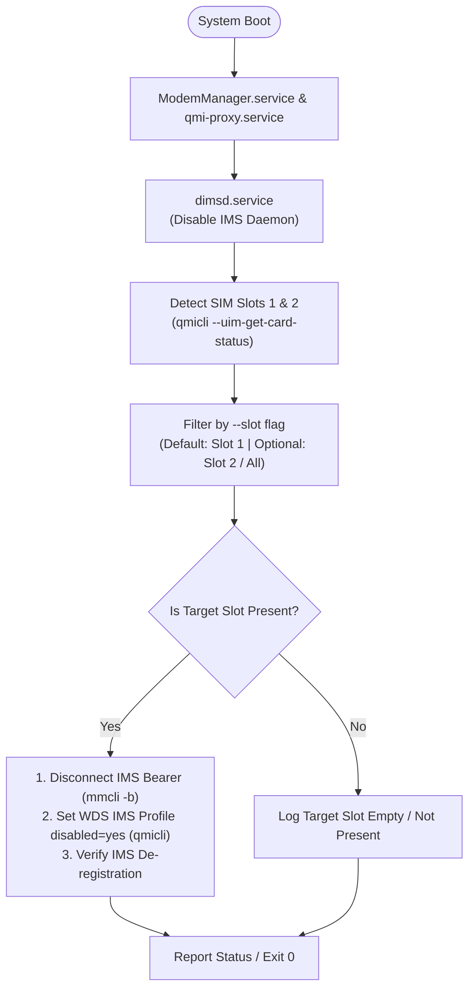

# `dimsd` (Disable IMS Daemon & CLI) - Plan & Specification

A robust, lightweight Rust daemon and CLI utility for **Nura OS** (postmarketOS / Alpine aarch64) designed to detect and manage IP Multimedia Subsystem (IMS/VoLTE) across **SIM slots** (Slot 1 & Slot 2), defaulting to Slot 1, while providing a complete CLI for monitoring status, disabling, and enabling IMS.

---

## 1. System Context & Hardware Topology

From inspection of the target device (`<target-device-ip>`):
- **Hardware**: Qualcomm MSM8953 (Snapdragon 625/450, 8-core ARM Cortex-A53 `aarch64`).
- **Operating System**: Nura OS edge (`ID_LIKE=alpine`, postmarketOS based).
- **Kernel**: Linux 7.1.3-msm8953.
- **Init System**: `systemd 262`.
- **Modem & Ports**:
  - Qualcomm SoC internal modem managed by ModemManager as `/org/freedesktop/ModemManager1/Modem/0`.
  - QMI / QRTR interface: `qrtr://0` (`qrtr0` port).
  - Network interface: `rmnet_ipa0`, multiplexed QMAP `qmapmux0.X`.
- **SIM Card Slots**:
  - Slot 1: Primary USIM/ISIM slot.
  - Slot 2: Secondary USIM/ISIM slot (DSDS dual-slot support).
- **System Services & Tools**: `/usr/sbin/qmicli`, `/usr/sbin/mmcli`, `ModemManager.service`, `qmi-proxy.service`.



---

## 2. Command Output Parsing & JSON Architecture

### ModemManager (`mmcli`) - Native JSON Output (`-J`)
`mmcli` natively supports JSON output via `-J` / `--output-json`:
- `mmcli -J -m 0`: Returns complete modem details in JSON, including active bearers, SIM paths, and state.
- `mmcli -J -b <id>`: Returns bearer configuration (APN, IP config, connected status) in structured JSON.
- `mmcli -J -i <sim_id>`: Returns SIM details (IMSI, operator, active status) in structured JSON.
`dimsd` uses `serde_json` to deserialize these payloads directly into strongly-typed Rust structs without fragile manual text parsing.

### QMI CLI (`qmicli`) - Robust Structured Text Parsing
`qmicli` does not provide a native `--json` flag. Its output consists of standardized key-value blocks and indented lists (e.g. `Slot [1]:`, `Card state: 'present'`, `Profile list retrieved:`).
`dimsd` incorporates dedicated parser modules with comprehensive regex and unit tests for:
- Card & Slot Status: `qmicli -p -d qrtr://0 --uim-get-card-status`
- Profile List: `qmicli -p -d qrtr://0 --wds-get-profile-list=3gpp`
- IMS Registration & Services: `qmicli -p -d qrtr://0 --imsa-get-ims-registration-status`

---

## 3. SIM Slot Targeting (Default: Slot 1)

Qualcomm modems in DSDS (Dual SIM Dual Standby) manage separate provisioning sessions and profiles per slot.

### Slot Identification & Selection
- **CLI Flag**: `-s, --slot <1|2|all>` (defaults to **`1`**).
- **Slot 1**:
  - Detected via `Slot [1]` in `qmicli --uim-get-card-status`.
  - Primary provisioning session (`Primary GW`).
  - Active bearers associated with primary SIM (`/org/freedesktop/ModemManager1/SIM/0`).
  - WDS 3GPP profile with APN `ims` (e.g. Profile 2).
- **Slot 2**:
  - Detected via `Slot [2]` in `qmicli --uim-get-card-status`.
  - Secondary provisioning session (`Secondary GW`).
  - ModemManager secondary SIM / bearer context.
- **Slot All**:
  - Automatically iterates over both slots if present.

### Disabling Procedure
1. Disconnects active ModemManager bearer(s) for the target slot with `apn: ims` using `mmcli -b <id> --disconnect`.
2. Disables the 3GPP WDS profile with APN `ims` using `qmicli -p -d qrtr://0 --wds-modify-profile="3gpp,<index>,disabled=yes"`.
3. Verifies that IMS status transitions to `not-registered` via `qmicli --imsa-get-ims-registration-status`.
4. **Disables autoconnection**: Ensures auto-connect is disabled for the IMS bearer/context in both ModemManager and QMI profile settings (`disabled=yes`, `autoconnect=no`) to permanently prevent background automatic reconnection.

### Enabling Procedure (`dimsd enable`)
1. Re-enables the 3GPP WDS profile: `qmicli -p -d qrtr://0 --wds-modify-profile="3gpp,<index>,disabled=no"`.
2. Verifies the profile status is active.

---

## 4. Dynamic Auto-Discovery & Configuration (`config.toml` & `dimsd check`)

### When is "auto" evaluated?
- **Every run / every boot**: When a setting in `config.toml` is set to `"auto"` (e.g. `device = "auto"` or `modem_id = "auto"`), `dimsd` performs a lightweight dynamic lookup (~15ms) on **every invocation**. This guarantees that if ModemManager re-enumerates the modem after a crash or firmware restart (e.g. from `Modem/0` to `Modem/1`), `dimsd` will never fail due to a stale hardcoded ID.
- **Specific values**: If the operator explicitly locks a field (e.g., `device = "qrtr://0"`), `dimsd` respects that value directly.
- **`dimsd check --update`**: Explicitly re-verifies all live hardware ports and updates `/etc/dimsd/config.toml` with the confirmed active values.

### Recommended Architectural Additions & Best Practices

1. **Boot Retry Loop with Timeout (`timeout_secs = 30`)**:
   - On cold boots, `ModemManager.service` may reach `active (running)` a few seconds before the Qualcomm modem finishes SIM card initialization.
   - `dimsd` implements an intelligent retry loop (polling every 1 second up to `timeout_secs`) until the target modem and SIM slot transition into `connected` or `registered` state, eliminating cold-boot race conditions.

2. **Case-Insensitive & Pattern APN Matching**:
   - Matches APN `ims`, `IMS`, and any bearer tagged with 3GPP IMS types, preventing carrier variations from slipping past.

3. **Persistent State Backup (`/var/lib/dimsd/state.json`)**:
   - Before modifying any WDS profile or disconnecting bearers, `dimsd` records the previous profile state (e.g., profile index, previous `disabled` setting).
   - This ensures `dimsd enable` and `uninstall.sh --restore` can restore the exact original configuration with 100% fidelity.

4. **Dry-Run Mode (`--dry-run`)**:
   - Both `dimsd disable --dry-run` and `dimsd enable --dry-run` show exactly what bearers would be disconnected and which WDS profiles would be modified without executing destructive actions.

---

## 5. Configuration File (`/etc/dimsd/config.toml`)
```toml
[modem]
# Device string: "auto" for dynamic detection, or explicit "qrtr://0", "/dev/cdc-wdm0"
device = "auto"

# ModemManager modem ID: "auto" for dynamic detection, or explicit index e.g. "0"
modem_id = "auto"

# Default SIM slot: 1, 2, or "all"
default_slot = 1

# Expected network interface: "auto" or specific "rmnet_ipa0"
net_interface = "auto"

[daemon]
# Modem readiness timeout during boot (seconds)
timeout_secs = 30

# Watchdog interval if running in persistent mode
poll_interval_secs = 10

# Auto-update config file when new ports or modem indices are detected
auto_sync_config = true

[logging]
level = "info"
```

---

## 6. CLI Design & Subcommands

Binary name: `dimsd`

```bash
# Default mode: disables IMS for configured default slot and exits 0 (for systemd service)
dimsd

# Explicit subcommands
dimsd status             # Display human-readable status of Slot 1, Slot 2, IMS bearers, and QMI profiles
dimsd disable            # Manually trigger IMS detachment (uses config default slot or --slot)
dimsd enable             # Re-enable IMS profiles
dimsd check [--update]   # Verify system modem details vs config.toml (optional --update to write live values)
dimsd daemon [--watch]   # Boot / background mode (optional --watch to monitor against re-attachment)
```

### Options & Flags
- `-s, --slot <1|2|all>`: Target SIM slot (default from config: `1`).
- `-c, --config <PATH>`: Configuration file path (default: `/etc/dimsd/config.toml`, fallback `./config.toml`).
- `-d, --device <DEV>`: Override QMI device (default: from config or `auto`).
- `-m, --modem <ID>`: Override ModemManager modem index (default: from config or `auto`).
- `--dry-run`: Simulate operations without modifying modem state.
- `--json`: Output status / result as JSON.
- `-v, --verbose`: Enable debug logging.
- `-q, --quiet`: Errors only.

---

## 5. Systemd Service Integration

The systemd service starts after ModemManager and QMI proxy have initialized:

### `/etc/systemd/system/dimsd.service`
```ini
[Unit]
Description=Disable IMS Daemon (dimsd)
After=ModemManager.service qmi-proxy.service
Wants=ModemManager.service qmi-proxy.service

[Service]
Type=oneshot
RemainAfterExit=yes
ExecStart=/usr/local/bin/dimsd disable --slot 1
StandardOutput=journal
StandardError=journal

[Install]
WantedBy=multi-user.target
```

---

## 6. Project Structure & Scripts

Project Root: `simctl`

```text
simctl/
├── Cargo.toml
├── config.example.toml    # Default example configuration
├── README.md              # Local documentation and reference manual
├── docs/
│   └── plan.md            # Complete architecture & implementation plan specification
├── scripts/
│   ├── install.sh         # Installation script (detects system, updates config.toml, sets up service)
│   └── uninstall.sh       # Clean uninstaller script with IMS restoration option
├── systemd/
│   └── simctl.service     # Systemd unit file
└── src/
    ├── main.rs            # Entrypoint & CLI execution
    ├── cli.rs             # Clap arguments & subcommands (status, disable, enable, check, daemon)
    ├── error.rs           # Thiserror error definitions
    ├── config.rs          # Config file loader, writer, and dynamic auto-detection
    └── modem/
        ├── mod.rs         # Orchestrator for Dual SIM & IMS management
        ├── types.rs       # SlotStatus, ImsStatus, BearerInfo, ProfileInfo, SystemHealth
        ├── mmcli.rs       # mmcli wrapper with serde_json deserialization
        └── qmicli.rs      # qmicli wrapper with regex/token parsing
```

### Scripts Specification (under `scripts/`)
- **`scripts/install.sh`**:
  - **Pre-flight Check**: Verifies dependencies (`qmicli`, `mmcli`, `systemctl`).
  - **Binary Installation**: Installs the compiled binary to `/usr/local/bin/dimsd` (`chmod 755`).
  - **Service Deployment**:
    - Creates `/etc/dimsd/` configuration directory and copies base configuration.
    - Installs `systemd/dimsd.service` to `/etc/systemd/system/dimsd.service`.
    - Reloads systemd daemon (`systemctl daemon-reload`).
    - Enables and starts the service (`systemctl enable --now dimsd.service`).
  - **Post-Activation Sync**: Once the service is enabled and active, executes `/usr/local/bin/dimsd check --update` to verify and atomically write the confirmed live hardware topology into `/etc/dimsd/config.toml`, reporting all details cleanly to the operator.
- **`scripts/uninstall.sh`**:
  - **IMS Restoration**: Offers `--restore` flag (or prompt) to run `/usr/local/bin/dimsd enable --slot all` to restore IMS profiles to enabled before removal.
  - Stops and disables `dimsd.service`.
  - Removes `/etc/systemd/system/dimsd.service`, `/usr/local/bin/dimsd`, and optionally `/etc/dimsd`.
  - Reloads systemd daemon.
